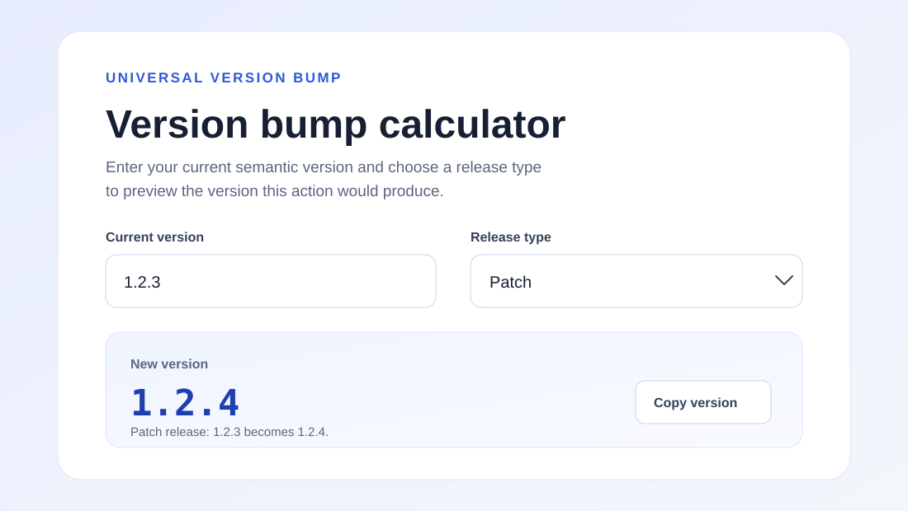
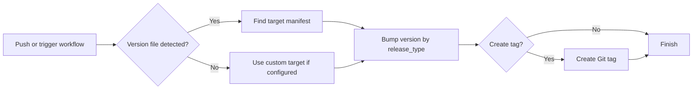

# Universal Version Bump

[](https://github.com/marketplace/actions/universal-version-bump)
[](https://github.com/taj54/universal-version-bump/releases)
[](https://github.com/taj54/universal-version-bump/actions/workflows/test.yml)
[](LICENSE)
[](CODE_OF_CONDUCT.md)
[](https://github.com/taj54/universal-version-bump/stargazers)
[](https://github.com/taj54/universal-version-bump/issues)
[](https://github.com/taj54/universal-version-bump/commits)

A GitHub Action for bumping semantic versions across a wide range of project types, including Node, Python, Java, .NET, Ruby, Go, Rust, Docker, and custom files.

This action automatically detects the most likely version manifest in your project, bumps it according to `release_type`, and can optionally create a Git tag and update your changelog.

## Live version-bump calculator

[](https://taj54.github.io/universal-version-bump/)

[Open the calculator](https://taj54.github.io/universal-version-bump/) to enter a version and preview a patch, minor, or major bump.

## Release flow



This gives you a simple, repeatable release pipeline that is fast to adopt and easy to customize.

## Why use this action?

- Auto-detects version files without hardcoding project-specific logic
- Works across many ecosystems with a single reusable workflow
- Supports monorepos and nested projects with `target_path`
- Lets you override detection when a project has multiple possible manifests
- Handles custom version files when your project is not using a standard manifest
- Can create a changelog entry and Git tag as part of the release workflow

## Supported ecosystems

The action inspects common version files in the repository root or in a selected target directory and updates the most likely candidate.

| Platform       | Typical version file(s)                                     |
| -------------- | ----------------------------------------------------------- |
| Deno           | `deno.json`, `jsr.json`                                     |
| Dart / Flutter | `pubspec.yaml`                                              |
| Docker         | `Dockerfile`                                                |
| Go             | `go.mod`                                                    |
| Java           | `pom.xml`, `build.gradle`, `build.gradle.kts`               |
| Node.js        | `package.json`                                              |
| PHP            | `composer.json`                                             |
| Python         | `pyproject.toml`, `setup.py`                                |
| Ruby           | `*.gemspec`, `version.rb`                                   |
| Rust           | `Cargo.toml`                                                |
| .NET           | `Directory.Build.props`, `*.csproj`, `*.fsproj`, `*.vbproj` |

Notes:

- For Ruby gemspecs, the action expects a literal assignment such as `spec.version = "1.2.3"`.
- For .NET projects, if no `Directory.Build.props` is found, the action uses the first project file alphabetically from the root. Use `target_path` to target a project explicitly.
- If no supported version file is found, the action fails unless you are using `target_platform: 'custom'` and `bump_targets`.

## Quick start

Add the action to a workflow:

```yaml
- name: Bump version
  uses: taj54/universal-version-bump@v1.0.0
  with:
    release_type: 'patch' # patch, minor, or major
```

This will:

1. Detect the project type and version file
2. Increment the version according to `release_type`
3. Update the changelog if configured
4. Create a Git tag if `git_tag` is enabled

## Common usage patterns

### Bump a specific directory

```yaml
- name: Bump app version
  uses: taj54/universal-version-bump@v1.0.0
  with:
    release_type: 'patch'
    target_path: 'apps/web'
```

Use this for monorepos or when the repository contains multiple apps, libraries, or services.

### Force a platform explicitly

```yaml
- name: Bump Node.js package version
  uses: taj54/universal-version-bump@v1.0.0
  with:
    release_type: 'minor'
    target_platform: 'node'
```

This is especially useful when multiple manifests exist or when your repository contains a mix of ecosystem files.

### Keep versioning consistent with a custom file

```yaml
- name: Bump custom version
  uses: taj54/universal-version-bump@v1.0.0
  with:
    release_type: 'patch'
    target_platform: 'custom'
    bump_targets: |
      [
        {"path": "version.txt", "variable": "APP_VERSION"},
        {"path": "config.json", "variable": "app.version"}
      ]
```

For JSON files, `variable` should be a JSON path, such as `app.version`. For plain text files, it is used as a regex target to find and replace the version string.

## Inputs

| Name              | Description                                                                                                       | Default        |
| ----------------- | ----------------------------------------------------------------------------------------------------------------- | -------------- |
| `release_type`    | Version bump style: `patch`, `minor`, or `major`                                                                  | `patch`        |
| `git_tag`         | Whether to create a Git tag after the version bump                                                                | `false`        |
| `target_platform` | Explicitly select a platform such as `node`, `python`, `java`, `dotnet`, `ruby`, `dart`, or `custom`              | `''`           |
| `target_path`     | Directory to inspect for the target version file                                                                  | `.`            |
| `changelog_path`  | Path to the changelog file                                                                                        | `CHANGELOG.md` |
| `changelog_mode`  | Whether to create a missing changelog (`auto`) or fail (`fail`)                                                   | `auto`         |
| `bump_targets`    | Custom file targets for `target_platform: 'custom'`; JSON array of `{ "path": "...", "variable": "..." }` entries | `[]`           |

## Outputs

| Name          | Description                                  |
| ------------- | -------------------------------------------- |
| `new_version` | The bumped version after the update          |
| `tag`         | The created Git tag, if `git_tag` is enabled |

## Example workflow

```yaml
name: Version bump

permissions:
  contents: write

on:
  workflow_dispatch:
    inputs:
      release_type:
        description: 'Version bump type'
        required: true
        default: 'patch'
        type: choice
        options:
          - patch
          - minor
          - major

jobs:
  bump:
    runs-on: ubuntu-latest
    steps:
      - name: Checkout
        uses: actions/checkout@v5
        with:
          fetch-depth: 0

      - name: Universal Version Bump
        uses: taj54/universal-version-bump@v1.0.0
        with:
          release_type: ${{ inputs.release_type }}
          git_tag: true
        env:
          GITHUB_TOKEN: ${{ secrets.GITHUB_TOKEN }}
```

## Behavior and platform detection

The action tries to detect the target version file based on the files present in the project directory. When multiple candidates exist, it prefers the file most commonly associated with the project type. This helps keep auto-detection reliable for standard repositories while still letting you override it explicitly with `target_platform`.

If you maintain a monorepo, nested service, or an application that contains several project manifests, use `target_path` or `target_platform` to avoid updating the wrong package or module.

## Development

For development and local contribution instructions, see [DEVELOPER.md](DEVELOPER.md).

## Contributing

Contributions are welcome. Please review [CONTRIBUTING.md](CONTRIBUTING.md) before submitting changes.

## Code of Conduct

This project follows the [Code of Conduct](CODE_OF_CONDUCT.md).

## License

This project is licensed under the [MIT License](LICENSE).
